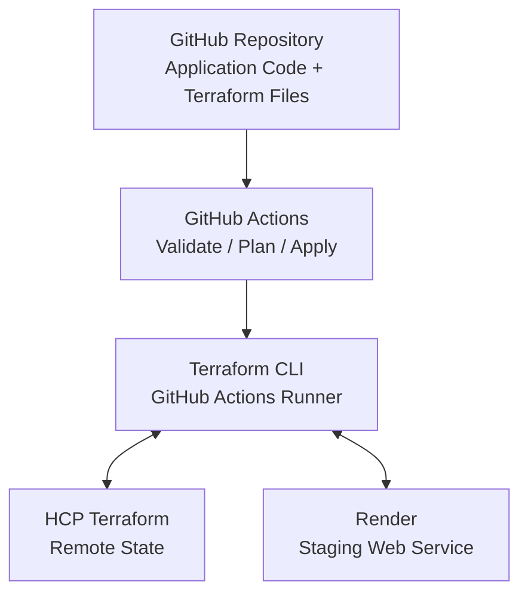

# Infrastructure as Code (IaC) Architecture

## 1. Overview and Tool Selection

The purpose of this project was to implement Infrastructure as Code (IaC) to automate the provisioning and management of a staging environment for the Task Manager API. Terraform was selected because it has an existing provider for Render, allowing us to provision and manage infrastructure without requiring extensive custom configuration or scripting.

Another reason for choosing Terraform was its ability to integrate with our existing GitHub Actions workflow. By storing the Terraform configuration files in GitHub, infrastructure changes can be tracked through version control, reviewed through pull requests, and validated before deployment. Terraform also supports reusable configuration files and variables, making it easier to maintain and expand the infrastructure as the project grows.

Terraform was used to define the staging environment, Render was used to host the application, and HCP Terraform was configured to manage the Terraform state remotely. GitHub Actions was integrated to automate infrastructure validation, planning, and provisioning.

To demonstrate infrastructure reproducibility, the staging environment was successfully destroyed using Terraform and recreated through GitHub Actions using the same configuration files.

## 2. Architecture and Infrastructure Components

# IaC Diagram



The infrastructure architecture consists of five main components: GitHub, GitHub Actions, Terraform, HCP Terraform, and Render. GitHub stores the application source code and Terraform configuration files, allowing infrastructure changes to be tracked through version control.

GitHub Actions executes the Terraform workflow, which validates the configuration, generates an execution plan, and applies infrastructure changes when manually triggered. Terraform communicates with Render through the Render provider to provision and manage the staging web service hosting the Task Manager API.

HCP Terraform stores the Terraform state remotely, allowing Terraform to track the infrastructure resources it manages. The workspace uses local execution mode, meaning Terraform commands are executed through GitHub Actions or a local terminal rather than directly within HCP Terraform.

The staging environment consists of a Render web service running the FastAPI application on a Starter instance in the Oregon region. The application currently uses in-memory storage, so no separate database was provisioned. Render manages the underlying hosting infrastructure and networking for the web service.


## 3. Configuration and Version Control

### Terraform configuration files

| File | Purpose |
|---|---|
| main.tf | Defines the Render staging web service |
| provider.tf | Configures the Render provider |
| versions.tf | Specifies Terraform requirements and HCP Terraform backend |
| variables.tf | Declares configurable infrastructure parameters |
| outputs.tf | Exposes the service ID, name, and URL |
| terraform.tfvars.example | Provides an example of variable configuration |
| .terraform.lock.hcl | Records provider dependency selections |


### Terraform Configuration

The Terraform configuration files are stored in the infrastructure/ directory of the GitHub repository. Each file has a specific responsibility, such as defining the Render web service, configuring the provider, declaring variables, and managing outputs. Separating these responsibilities makes the infrastructure easier to understand, maintain, and modify.

The staging environment is defined in main.tf using the render_web_service resource. This resource configures the service name, hosting plan, region, application repository, build command, start command, and health check. Terraform uses the Render provider to communicate with Render and manage the service.

Variables are used to parameterize settings such as the service name, instance plan, region, and GitHub repository URL. This reduces hard-coded values and allows the configuration to be reused or modified without changing the main resource definition. Outputs provide information about the provisioned service, including its ID, name, and public URL.

Sensitive credentials, including the Render API key and owner ID, are supplied through environment variables and GitHub Actions secrets rather than being stored directly in the Terraform configuration file.

### Version Control Strategy

The Terraform configuration is managed using Git and GitHub. Infrastructure changes were developed on the feature/terraform-staging branch rather than directly on the main branch. This allowed changes to be committed, tested, and reviewed independently before integration.

GitHub Actions was configured to validate the Terraform configuration and generate an execution plan. Pull requests provide an opportunity to review infrastructure changes before merging them into the main branch.

This branching strategy helps protect the main branch from untested infrastructure changes while maintaining a history of configuration updates and workflow modifications.


## 4. Provisioning and Deployment Guide

The staging environment can be provisioned using Terraform through GitHub Actions or a local terminal. Before provisioning, the user must have access to the GitHub repository, a Render account with the appropriate permissions, and the configured HCP Terraform workspace.

### Prerequisites

The following tools and services are required:

- Terraform CLI installed locally for manual infrastructure management.
- A Render account with a valid API key and owner ID.
- Access to the HCP Terraform workspace used for remote state management.
- A GitHub repository containing the application and Terraform configuration.
- GitHub Actions secrets configured for Terraform and Render authentication.

### Local Terraform Setup

Navigate to the **infrastructure/** directory and configure the required environment variables.

```bash
export RENDER_API_KEY="your-render-api-key"
export RENDER_OWNER_ID="your-render-owner-id"
export TF_VAR_repo_url="https://github.com/BlueShirt03/task-manager-ci"
```

Authenticate with HCP Terraform using **terraform login**, if necessary.

Initialize and validate the Terraform configuration:

```bash
terraform init
terraform fmt -check
terraform validate
```

Generate an execution plan to review the infrastructure changes:

```bash
terraform plan
```

To provision the staging environment locally, execute:

```bash
terraform apply
```

Terraform will display the proposed changes and request confirmation before applying them.

### Provisioning Through GitHub Actions

The Terraform workflow is located in **.github/workflows/terraform.yml**. It automates configuration validation and planning, while infrastructure provisioning is initiated through a manual workflow trigger.

To provision the staging environment:

1. Navigate to the GitHub repository and open the Actions tab.
2. Select the Terraform Infrastructure workflow.
3. Click Run workflow and select the appropriate branch.
4. Choose **apply** as the Terraform operation.
5. Run the workflow and verify that the Terraform Apply job completes successfully.

After provisioning, the Render dashboard should display the **task-manager-iac-staging** web service. The application can be verified by opening the service's public URL and checking that the Task Manager API responds successfully.


## 5. Environment Reproducibility and Testing

To verify infrastructure reproducibility, the staging environment was destroyed and recreated using the same Terraform configuration files. This test demonstrated that Terraform could consistently provision the required infrastructure without manually configuring the Render web service.

### Destroying the Staging Environment

The destruction process was performed locally using the Terraform CLI. Before destroying the environment, the **terraform plan -destroy** command was executed to review which resources would be removed.

The execution plan identified one resource, **render_web_service.staging**, with zero resources to add or modify. After reviewing the plan, the **terraform destroy** command was executed to remove the staging web service.

The destruction was verified by checking the Render dashboard and confirming that the service was no longer available.

### Recreating the Staging Environment

After successfully destroying the staging environment, the infrastructure was recreated through GitHub Actions. The Terraform Infrastructure workflow was manually triggered with the **apply** operation.

Terraform used the existing configuration files and the remote state stored in HCP Terraform to determine that the staging web service needed to be recreated. The workflow completed successfully, and the Render web service was provisioned again.

The recreated environment was verified by checking the Render dashboard and confirming that the Task Manager API was accessible through its public URL.

### Testing Results

| Test | Expected Result | Actual Result |
|---|---|---|
| Terraform destroy plan | Identify one resource for destruction | Passed |
| Terraform destroy | Remove staging web service | Passed |
| Render verification | Staging service no longer exists | Passed |
| Terraform Apply | Recreate staging web service | Passed |
| Application verification | Task Manager API responds successfully | Passed |

### Conclusion

The destroy-and-recreate test demonstrated that the staging environment could be reproduced using Terraform without manually rebuilding the infrastructure through the Render dashboard. By maintaining the infrastructure configuration in GitHub and storing Terraform state remotely, the staging environment can be managed consistently through the existing CI/CD workflow.


